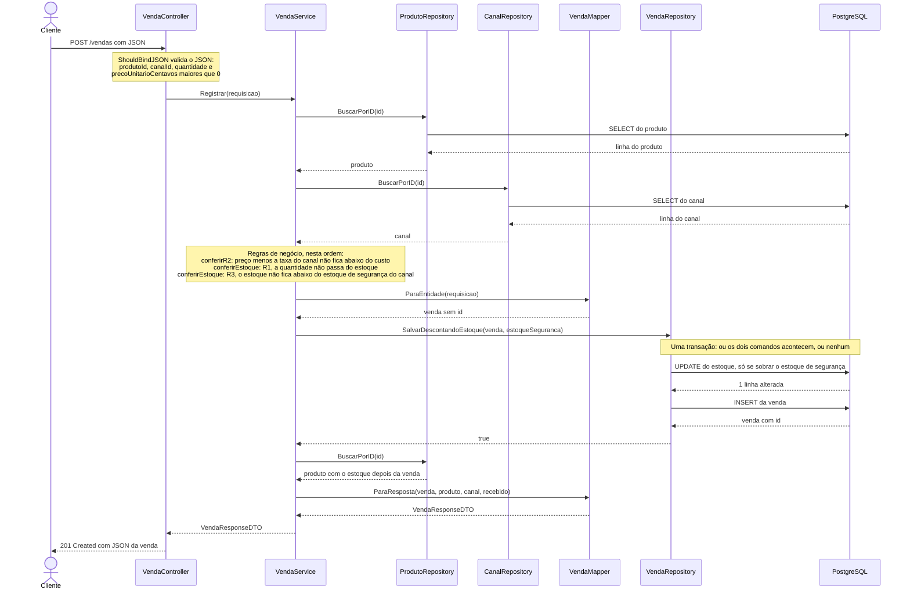

# O caminho de uma venda

`POST /vendas` é a rota mais importante do SyncVault: é nela que uma venda de qualquer canal (Balcão, Mercado Livre ou Shopee) desconta do mesmo estoque, e é nela que as regras R1, R2 e R3 são conferidas. Este documento mostra, classe por classe, por onde a requisição passa.

## 1. O caminho de uma venda que dá certo

A requisição:

```json
{
  "produtoId": 1,
  "canalId": 2,
  "quantidade": 1,
  "precoUnitarioCentavos": 10990
}
```

O caminho até a resposta:



A resposta, `201 Created`:

```json
{
  "id": 1,
  "produto": { "id": 1, "nome": "Casaco corta-vento", "custoCentavos": 6000, "estoque": 4 },
  "canal": { "id": 2, "nome": "Mercado Livre", "taxaPercentual": 16, "estoqueSeguranca": 2 },
  "quantidade": 1,
  "precoUnitarioCentavos": 10990,
  "recebidoCentavos": 9231,
  "vendidaEm": "2026-10-20T19:30:00-03:00"
}
```

Dois detalhes do desenho:

- **A transação.** `SalvarDescontandoEstoque` abre uma transação com dois comandos: o `UPDATE` que desconta o estoque e o `INSERT` da venda. Se um falhar, o banco desfaz o outro. Nunca fica uma venda gravada sem o estoque descontado, nem o contrário.
- **O produto é lido duas vezes.** A segunda leitura, depois de gravar, é para a resposta mostrar o estoque já descontado (no exemplo, 4 em vez de 5).

## 2. Onde cada pedido é barrado

Quando um pedido é barrado, a requisição não chega ao fim do caminho acima. O erro sobe até o Controller, que o entrega com `ctx.Error(err)`. Quem transforma o erro na resposta HTTP é o tratamento central de erros, `TratarErros`, em `internal/controller/tratamento_de_erros.go`.

| Situação | Quem barra (arquivo e função) | Resposta |
|---|---|---|
| JSON ilegível ou campo inválido (por exemplo, `quantidade` 0) | `internal/controller/venda_controller.go`, `Registrar`, pelo `ShouldBindJSON`. As regras de cada campo (`required,gt=0`) estão em `VendaRequestDTO`, em `internal/dto/venda_dto.go` | `400` |
| Produto que não existe | `internal/service/venda_service.go`, `Registrar`: o `BuscarPorID` devolve `nil` e o Service cria o erro com `ProdutoNaoEncontrado` (`internal/service/erros.go`) | `404` |
| Canal que não existe | `internal/service/venda_service.go`, `Registrar`: o `BuscarPorID` devolve `nil` e o Service cria o erro com `CanalNaoEncontrado` (`internal/service/erros.go`) | `404` |
| R2 violada | `internal/service/venda_service.go`, `conferirR2` | `400` |
| R1 violada | `internal/service/venda_service.go`, `conferirEstoque` (primeira conferência) | `400` |
| R3 violada | `internal/service/venda_service.go`, `conferirEstoque` (segunda conferência) | `400` |
| Duas vendas ao mesmo tempo disputando a última peça | `internal/repository/venda_repository.go`, `SalvarDescontandoEstoque`: o `UPDATE` só altera a linha se sobrar o estoque de segurança, e o banco executa um de cada vez. A venda que perde recebe `false`, e `Registrar` confere de novo com o estoque atual | `400` (R1 ou R3) |

Sobre a última linha: a venda que perdeu a disputa vê o estoque já descontado e recebe a mensagem da regra que passou a valer, R1 ou R3. Se o estoque tiver voltado a ser suficiente entre as duas leituras, `Registrar` devolve o erro simples "o estoque mudou durante a venda; tente de novo". O status desse caso depende do `TratarErros`, que ainda está sendo feito.

## 3. Por que a regra não fica no Controller nem no Repository

A regra de negócio mora no Service porque cada camada tem um único trabalho. O Controller entende de HTTP: lê o JSON, entrega ao Service e devolve o status e o corpo, sem decidir nada do domínio. O Repository entende de banco: lê e grava, sem decidir nada. Se R1, R2 e R3 ficassem no Controller, elas estariam presas ao HTTP e teriam de ser copiadas em qualquer outra porta de entrada. Se ficassem no Repository, estariam presas ao banco e misturadas com SQL. No Service elas ficam em um lugar só, na ordem R2, R1 e R3, e podem ser lidas e mudadas sem mexer na rota nem no banco. É a segunda das "Três regras do desenho" do ARQUITETURA.md: regra de negócio mora no Service.

O `UPDATE` condicional do `SalvarDescontandoEstoque` repete a conta de R1 e R3 dentro do banco. Isso não quebra a regra: o Service continua sendo quem decide e dá a mensagem certa. A repetição existe só para que duas vendas simultâneas não levem a mesma última peça.
