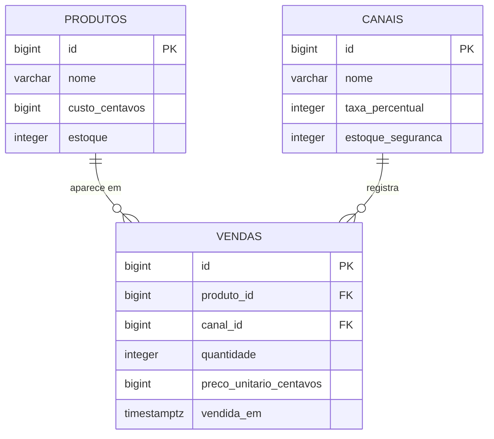

# Modelo de domínio

O SyncVault guarda um estoque só para todos os canais onde a loja vende (balcão, Mercado Livre, Shopee...). Cada venda informa o canal e o preço praticado ali, e desconta do mesmo estoque.

Duas convenções valem para todas as tabelas:

- **Dinheiro em centavos, como número inteiro.** R$ 49,90 é guardado como `4990`. Número com casas decimais erra conta de dinheiro (`0,1 + 0,2` dá `0,30000000000000004`), e inteiro não erra. Por isso as colunas de valor terminam em `_centavos`.
- **Percentual como número inteiro.** `16` quer dizer 16%.

## Entidades

Uma tabela por entidade. A coluna **Regra** é o que vira `NOT NULL`, `CHECK` ou validação no DTO.

### Produto

Um item à venda, com um estoque só para todos os canais.

| Atributo | Tipo Go | Coluna | Obrigatório | Regra |
|---|---|---|---|---|
| `ID` | `int64` | `id` | sim | Gerado pelo banco |
| `Nome` | `string` | `nome` | sim | Até 255 caracteres |
| `CustoCentavos` | `int64` | `custo_centavos` | sim | Maior que zero. Quanto a loja pagou por uma unidade. Entra na conta da R2 |
| `Estoque` | `int` | `estoque` | sim | Zero ou mais. Informado no cadastro; depois disso, só a venda mexe nele (R1 e R3) |

### Canal

Um lugar onde a loja vende: o balcão da loja física ou um marketplace.

| Atributo | Tipo Go | Coluna | Obrigatório | Regra |
|---|---|---|---|---|
| `ID` | `int64` | `id` | sim | Gerado pelo banco |
| `Nome` | `string` | `nome` | sim | Até 100 caracteres |
| `TaxaPercentual` | `int` | `taxa_percentual` | sim | De 0 a 100. A comissão que o canal fica de cada venda. No balcão é 0. Entra na conta da R2 |
| `EstoqueSeguranca` | `int` | `estoque_seguranca` | sim | Zero ou mais. Quantas unidades este canal não pode vender, porque o marketplace atualiza o estoque com atraso (R3). No balcão é 0 |

### Venda

A venda de um produto, registrada por um canal.

| Atributo | Tipo Go | Coluna | Obrigatório | Regra |
|---|---|---|---|---|
| `ID` | `int64` | `id` | sim | Gerado pelo banco |
| `ProdutoID` | `int64` | `produto_id` | sim | O produto precisa existir |
| `CanalID` | `int64` | `canal_id` | sim | O canal precisa existir |
| `Quantidade` | `int` | `quantidade` | sim | Maior que zero. Não pode passar do estoque (R1) nem invadir o estoque de segurança do canal (R3) |
| `PrecoUnitarioCentavos` | `int64` | `preco_unitario_centavos` | sim | Maior que zero. O preço praticado neste canal; descontada a taxa, não pode ficar abaixo do custo (R2) |
| `VendidaEm` | `time.Time` | `vendida_em` | sim | A API preenche com o momento da venda; o cliente não envia |

## Relacionamentos

| De | Para | Tipo | No banco | No código |
|---|---|---|---|---|
| Venda | Produto | muitos para um | `vendas.produto_id` referencia `produtos(id)` | Campo `ProdutoID` na struct `Venda` |
| Venda | Canal | muitos para um | `vendas.canal_id` referencia `canais(id)` | Campo `CanalID` na struct `Venda` |

## Diagrama ER

Como ler: `||--o{` é "um para muitos". Um produto aparece em zero ou várias vendas, e cada venda é de exatamente um produto. O mesmo vale para canal e venda.

## Migrations

Ficam em `migrations/`, uma tabela por arquivo, no formato do golang-migrate: `<versão>_<o_que_faz>.up.sql`. A API aplica as que ainda não rodaram quando sobe. A ordem importa: as tabelas que `vendas` referencia nascem antes dela.

| Versão | Arquivo | O que cria |
|---|---|---|
| 1 | `000001_criar_produtos.up.sql` | Tabela `produtos` |
| 2 | `000002_criar_canais.up.sql` | Tabela `canais` |
| 3 | `000003_criar_vendas.up.sql` | Tabela `vendas`, com as duas chaves estrangeiras |
